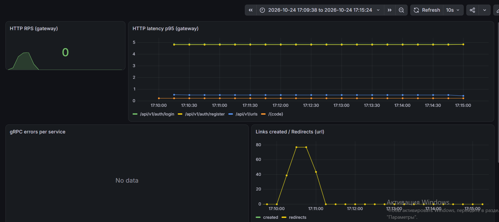
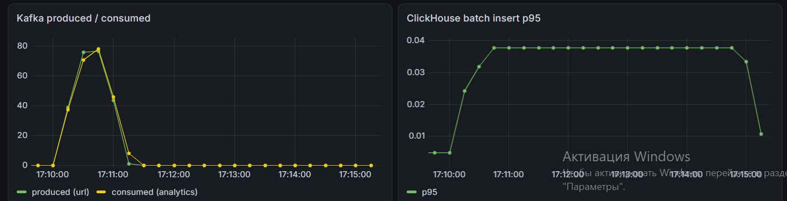

# URL Shortener

Микросервисный сокращатель ссылок на Go: gRPC, PostgreSQL, MongoDB, Redis, Kafka, ClickHouse, 
observability (Prometheus, Grafana, Jaeger, Loki), Docker Compose, CI/CD, 
нагрузочное тестирование (k6).

## Архитектура
Client -> Gateway (REST) -> User (gRPC) / URL (gRPC) / Analytics (gRPC)

## Сервисы

| Сервис        | Протокол  | База       | Кеш | Очередь        |
|---------------|-----------|------------|-----|----------------|
| **User**      | gRPC      | PostgreSQl |Redis| —              |  
| **URL**       | gRPC      | MongoDB    |Redis| Kafka produser |
| **Gateway**   | Rest(chi) | —          |  —  |   —            | 
| **Analytics** | gRPC      | ClickHouse | —   | Kafka consumer | 

## Технологии

- **Язык:** Go 1.26
- **RPC:** gRPC + Protobuf (buf)
- **REST:** chi
- **Базы:** PostgreSQL, MongoDB, ClickHouse
- **Кеш:** Redis
- **Очередь:** Kafka
- **Мониторинг:** Prometheus, Grafana
- **Трейсинг:** OpenTelemetry, Jaeger
- **Логи:** slog (JSON), Loki, Promtail
- **Контейнеризация:** Docker, Docker Compose
- **CI:** GitHub Actions
- **Нагрузочное тестирование:** k6

## Запуск

### 1. Поднять инфраструктуру
make up
### 3. Применить миграции
make migrate-up
### 4. Запустить сервисы(каждый в своем терминале)
make run-user
make run-url
make run-gateway
make run-analytics
### 5. Проверить, что все работет 
Регистрация

curl -s -X POST localhost:8080/api/v1/auth/register \
-d '{"email":"a@b.com","password":"password123"}'

Логин

curl -s -X POST localhost:8080/api/v1/auth/login \
-d '{"email":"a@b.com","password":"password123"}'

Создание ссылки (подставь access_token из ответа логина)

curl -s -X POST localhost:8080/api/v1/urls \
-H 'Authorization: Bearer <access_token>' \
-d '{"original_url":"https://example.com"}'

Редирект (подставь short_code из ответа создания)

curl -si localhost:8080/<short_code>

## Остановить 
make down


## Порты

| Сервис                   | Порт  | URL                                 |
|--------------------------|-------|-------------------------------------|
| API Gateway              | 8080  | http://localhost:8080               |
| User Service (gRPC)      | 50051 | —                                   |
| URL Service (gRPC)       | 50052 | —                                   |
| Analytics Service (gRPC) | 50053 | —                                   |
| Prometheus               | 9090  | http://localhost:9090               |
| Grafana                  | 3000  | http://localhost:3000 (admin/admin) |
| Jaeger UI                | 16686 | http://localhost:16686              |
| Loki                     | 3100  | —                                   |
| ClickHouse HTTP          | 8123  | —                                   |
| ClickHouse native        | 9000  | —                                   |
| MongoDB                  | 27017 | —                                   |
| PostgreSQL               | 5432  | —                                   |
| Redis                    | 6379  | —                                   |
| Kafka                    | 9092  | —                                   |
| Метрики user             | 9091  | http://localhost:9091/metrics       |
| Метрики url              | 9092  | http://localhost:9092/metrics       |
| Метрики gateway          | 9093  | http://localhost:9093/metrics       |
| Метрики analytics        | 9094  | http://localhost:9094/metrics       |

## Сценарий проверки

 Регистрация
curl -s -X POST localhost:8080/api/v1/auth/register \
  -d '{"email":"a@b.com","password":"password123"}'
 → {"user_id":"..."}

 Логин
curl -s -X POST localhost:8080/api/v1/auth/login \
  -d '{"email":"a@b.com","password":"password123"}'
 → {"access_token":"eyJ...","refresh_token":"eyJ..."}

 Создание ссылки (подставь access_token из ответа логина)
curl -s -X POST localhost:8080/api/v1/urls \
  -H 'Authorization: Bearer <access_token>' \
  -d '{"original_url":"https://example.com"}'
 → {"short_code":"abc1234","short_url":"https://short.url/abc1234"}

 Редирект (подставь short_code из ответа создания)
curl -si localhost:8080/abc1234
 → 302 Found, Location: https://example.com

 Аналитика (подставь access_token и short_code)
curl -s -H 'Authorization: Bearer <access_token>' \
  'localhost:8080/api/v1/analytics/abc1234?days=30'
 → {"short_code":"abc1234","total_clicks":1,"clicks_by_day":[...],"top_referers":[...]}

## Observability

- **Метрики:** Prometheus скрейпит `/metrics` каждого сервиса. Дашборд Grafana — в папке **URL Shortener** (провиженится автоматически).
- **Трейсы:** OpenTelemetry → Jaeger. Сквозной трейс одного запроса виден в Jaeger UI (http://localhost:16686).
- **Логи:** slog JSON с `trace_id` → Promtail → Loki → Grafana Explore. По `trace_id` из лога находится трейс в Jaeger.
- **pprof:** на ops-порту каждого сервиса (`/debug/pprof/`). Пример: `go tool pprof http://localhost:9091/debug/pprof/heap`.




## Нагрузочное тестирование
k6 run --out json=load/result.json load/script.js

## Сценарий проверки (Полный флоу)

**1. Регистрация**
```bash
curl -s -X POST localhost:8080/api/v1/auth/register \
  -d '{"email":"a@b.com","password":"password123"}'
# → {"user_id":"..."}
```

**2. Логин**
```bash
curl -s -X POST localhost:8080/api/v1/auth/login \
  -d '{"email":"a@b.com","password":"password123"}'
# → {"access_token":"eyJ...","refresh_token":"eyJ..."}
```

**3. Создание ссылки** (подставь `access_token` из ответа логина)
```bash
curl -s -X POST localhost:8080/api/v1/urls \
  -H 'Authorization: Bearer <access_token>' \
  -d '{"original_url":"https://example.com"}'
# → {"short_code":"abc1234","short_url":"https://short.url/abc1234"}
```

**4. Редирект** (подставь `short_code` из ответа создания)
```bash
curl -si localhost:8080/abc1234
# → 302 Found, Location: https://example.com
```

**5. Аналитика** (подставь `access_token` и `short_code`)
```bash
curl -s -H 'Authorization: Bearer <access_token>' \
  'localhost:8080/api/v1/analytics/abc1234?days=30'
# → {"short_code":"abc1234","total_clicks":1,"clicks_by_day":[...],"top_referers":[...]}
```